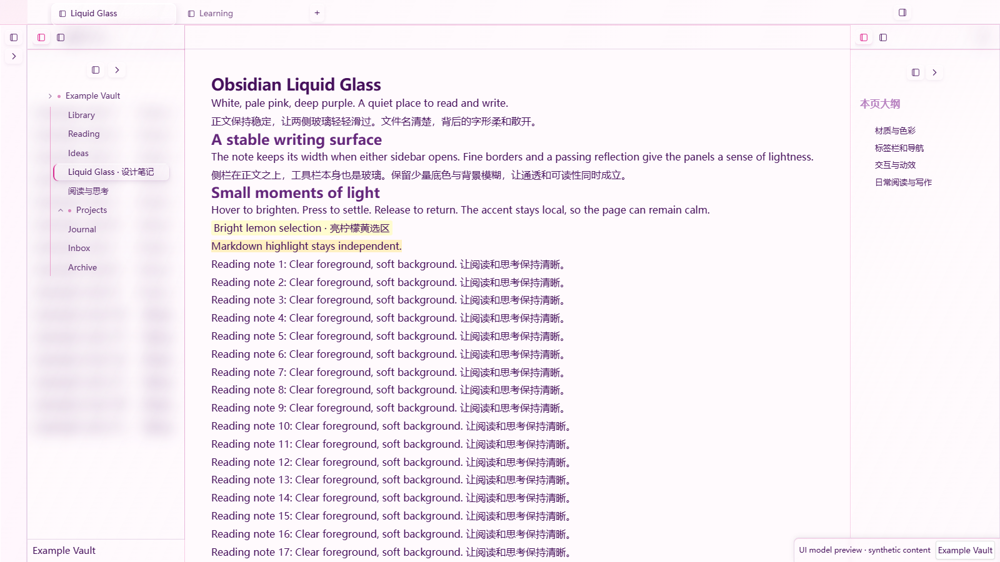
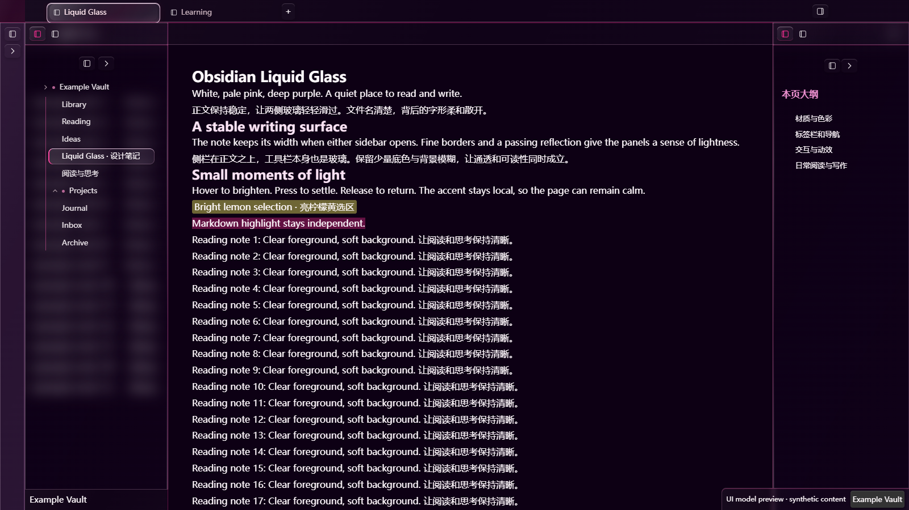

# Obsidian Liquid Glass

A desktop theme with white and pale pink surfaces, deep purple text, magenta accents, and glass sidebars that slide over a stable writing area.

[中文说明](#中文说明) · [Download 0.1.0](https://github.com/XuMintian/obsidian-liquid-glass/releases/tag/0.1.0) · [Optional interaction plugin](https://github.com/XuMintian/obsidian-liquid-glass-interactions)

These images are rendered UI model previews with synthetic example text, not screenshots of a running Obsidian vault.

## What it changes

- Left and right sidebars slide over the note without resizing its text or top toolbar.
- Sidebar glass uses a 12px background blur and a restrained tint, keeping file names sharp while softening text behind them.
- The note toolbar itself is glass. Scrolling text passes behind it.
- Tabs, navigation buttons, file rows, the ribbon, and the status bar share highlights, fine borders, hover feedback, and press/release motion.
- Text selection is bright lemon yellow, separate from Markdown `==highlight==`.
- The writing area is centered with a responsive maximum width of 1040px.

The theme works without plugins. The optional **Liquid Glass Interactions** plugin closes open sidebars when you click inside a Markdown note. CSS alone cannot provide that behavior.

## Install

This is an initial GitHub beta. It is **not listed in the Obsidian Community Themes directory**.

1. Download `Obsidian-Liquid-Glass-0.1.0.zip` from the release.
2. Extract its `Obsidian Liquid Glass` folder into `<vault>/.obsidian/themes/`.
3. In Obsidian, open **Settings → Appearance → Themes** and select **Obsidian Liquid Glass**. Restart Obsidian if the theme has not appeared yet.
4. Enable the view header to see scrolling text behind the note toolbar. Enable readable line length for the centered writing area.

Alternatively, place `theme.css` and `manifest.json` together in `<vault>/.obsidian/themes/Obsidian Liquid Glass/`.

Use Obsidian's normal light/dark mode switch. Your existing fonts are preserved. The optional `extras/optional-handwriting.css` snippet provides the original handwriting/serif combination using fonts already installed on your computer; no font files are included.

If you are migrating from the original development snippets, disable those snippets when activating this theme to avoid duplicate styling. You can leave your existing handwriting snippet enabled if you want its font choices.

## Palette

| Role | Light | Dark |
| --- | --- | --- |
| Background | `#FFFAFD` | `#0D0014` |
| Body text | `#46115C` | `#FFFAFD` |
| Accent | `#E02C91` | `#FF2E95` |
| Links / supporting text | `#D12B7F` links | `#FFE6EE` supporting text |
| Text selection | `#FFFF66` at 30% | `#FFFF66` at 40% |

## Compatibility and limits

The implementation targets **Obsidian 1.14.4 desktop**. The original configuration was accepted by its user after successive visual adjustments. The exported theme has also been checked in an Edge/Chromium model using Obsidian 1.14.4's native styles: light/dark rendering, stable note geometry, sidebar and toolbar blur, button hit regions, keyboard focus, selection, and accessibility fallbacks.

The exported theme has not received a full live-app regression pass. macOS/Linux, other Obsidian versions, Chinese IME, native drag operations, third-party plugins, and long-document performance need broader testing. Mobile receives the basic palette and typography but not the desktop overlay sidebars; it is not a supported glass layout.

The toolbar overlap is limited to ordinary main-workspace Markdown views. Search/replace, hidden headers, stacked tabs, printing, and unsupported blur engines fall back to native layout. Third-party sidebar views may retain opaque backgrounds. This is CSS glass inspired by Liquid Glass; it does not simulate physical refraction or reveal the desktop wallpaper.

Reduced-motion preferences disable the added reflections and CSS motion; Obsidian's native sidebar width animation remains. Reduced-transparency preferences use solid surfaces where supported by the host. There are no remote fonts, images, or runtime network requests.

## Development

`src/order.json` defines the module order. Run `node build.mjs` to regenerate `theme.css`, or `node build.mjs --check` to verify the checked-in bundle. Node is only needed for development, not installation.

Report issues with your Obsidian version, OS, light/dark mode, enabled snippets/plugins, and a screenshot that does not expose private note contents. The theme relies on some host DOM details, so Obsidian updates may require adjustments.

The current name follows the project's chosen GitHub identity. The official community naming rules disallow “Obsidian” in a theme name; a community submission would require a compliant name and account linking first.

## 中文说明

这套主题以白色、极淡粉白和深紫色为基础，用洋红色做局部强调。正文保持稳定，左右侧栏像上层玻璃一样滑入；工具栏自身透明模糊，滚动文字可以从它后面经过。

侧栏采用 12px 背景模糊与少量底色，让背后的正文散开，同时保持文件名清楚。标签、文件树、图标按钮、Ribbon 和状态栏使用同一套玻璃细节与交互。划词选区是亮柠檬黄，与 Markdown 高亮互相独立。

安装：从 [Release](https://github.com/XuMintian/obsidian-liquid-glass/releases/tag/0.1.0) 下载 ZIP，把其中的 `Obsidian Liquid Glass` 文件夹放入仓库的 `.obsidian/themes/`，然后在“设置 → 外观 → 主题”选择它。开启“显示当前标签页标题栏”和“缩减栏宽”可使用对应的工具栏与居中版心效果。原有开发版玻璃片段应先关闭，避免重复覆盖。

默认保留你在 Obsidian 中选择的字体。想使用原版手写风格，可将 `extras/optional-handwriting.css` 放入 `.obsidian/snippets/` 并启用；它只引用本机字体，不包含字体文件。

点击笔记正文自动收起侧栏，需要另外安装 [Liquid Glass Interactions](https://github.com/XuMintian/obsidian-liquid-glass-interactions)。主题本身无需插件即可工作。

当前为 GitHub 初始测试版，面向 Obsidian 1.14.4 桌面端，尚未进入官方社区主题列表。上方图片是示例文字的模型预览，不是实机截图；导出版本尚需更多跨平台与插件兼容测试。社区规则不接受名称中的 “Obsidian”，申请社区收录时需要调整显示名称。

## License

MIT. This is an independent community project, not an official Obsidian or Apple product. Obsidian's application assets and fonts are not distributed in this repository.
